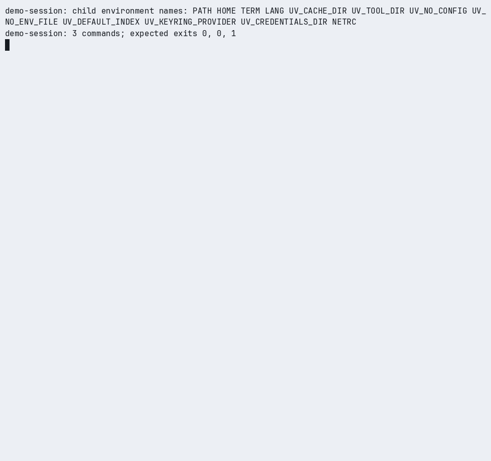

# Actseal

Actseal tells you how much of a categorical decision a model can make alone at your error limit, with evidence anyone can replay offline.

**Engineering:** [20 ADRs](https://github.com/ajaysurya1221/actseal/tree/main/docs/decisions) · [16 JSON Schemas](https://github.com/ajaysurya1221/actseal/blob/main/docs/schemas/README.md)
[Mutation harness](https://github.com/ajaysurya1221/actseal/blob/main/tools/check_mutations.py) · [1.0.1 release receipt](https://github.com/ajaysurya1221/actseal/blob/main/plan/v1/releases/1.0.1/postpublish-receipt.json)

[](https://github.com/ajaysurya1221/actseal/actions/workflows/ci.yml)
[](https://pypi.org/project/actseal/)
[](https://pypi.org/project/actseal/)
[](https://github.com/ajaysurya1221/actseal/blob/main/LICENSE)

## 60-second quickstart (synthetic)

2.0.0 is unreleased. From this checkout with its locked development environment
installed, run on macOS/Linux with [uv](https://docs.astral.sh/uv/getting-started/installation/):

```bash
uv run --frozen actseal demo --qualify --out ./actseal-qualified-demo
uv run --frozen actseal report ./actseal-qualified-demo --out ./actseal-report
uv run --frozen actseal replay-selection ./actseal-qualified-demo/calibration
uv run --frozen actseal replay ./actseal-qualified-demo/evidence
```

All four commands exit 0. The authored synthetic example selects threshold
`0.95` using 64 calibration cases, then returns PASS on 100 separate verification
cases at risk limit `0.2`, coverage floor `0.5` and alpha `0.05`. This is a
workflow demonstration, not a model measurement; no model or API key is needed.
Use new output directories. Open `actseal-report/report.html` for the headline,
counts and limits; Markdown and badge JSON are written beside it.

[Use it in an application](https://github.com/ajaysurya1221/actseal/blob/main/examples/action_gate/README.md) · [Read the limits](https://github.com/ajaysurya1221/actseal/blob/main/docs/threat-model.md) · [Quickstart](https://github.com/ajaysurya1221/actseal/blob/main/docs/quickstart.md)

## Bring your own predictions

Use the `recorded` provider for predictions from any model. Put one row per
case in `predictions.jsonl`, covering both labelled splits; these three rows
illustrate the format, not an adequate verification sample:

```jsonl
{"case_id":"cal-001","choice":"accept","score":0.95}
{"case_id":"cal-002","choice":"review","score":0.7}
{"case_id":"verify-001","choice":"accept","score":0.98}
```

Prepare `contract.toml` with your question, allowed labels, risk/coverage limits
and alpha, plus `calibration.jsonl` and `verification.jsonl` with `case_id`,
`state` and `expected_label` in each row. The contract's template threshold is
replaced by selection. See the [input formats](https://github.com/ajaysurya1221/actseal/blob/main/plan/CONTRACTS.md)
and [provider guide](https://github.com/ajaysurya1221/actseal/blob/main/docs/providers.md).
Choose the grid and limits before calibration, keep split IDs and state texts
disjoint, and use a new output directory:

```bash
uv run --frozen actseal qualify \
  --contract ./contract.toml \
  --calibration ./calibration.jsonl \
  --verification ./verification.jsonl \
  --provider recorded --responses ./predictions.jsonl \
  --model my-model --revision my-revision \
  --grid 0.5 0.6 0.7 0.8 0.9 0.95 1.0 \
  --offline --out ./qualification
```

Scores are supplied values in `[0, 1]`; Actseal does not calibrate them or
invent probability maps. Selection is recorded before verification, and a
no-threshold result is INCONCLUSIVE without running verification.
Reports state **recorded: provider faults not tested**.

## Plan before collecting cases

Estimate the verification sample size at your assumed risk and coverage before
collecting predictions:

```bash
uv run --frozen actseal plan --max-risk 0.05 --min-coverage 0.5 --alpha 0.05 \
  --expected-risk 0.01 --expected-coverage 0.9
```

The planner makes no model call. Its first feasible scheduled size is a
design-point calculation, not a promise of PASS. Keep a separate calibration
split; do not repeatedly reuse verification cases until a policy passes.

## GitHub Action

For a checkout of this repository containing the prepared files above:

```yaml
permissions:
  contents: read
steps:
  - uses: actions/checkout@3d3c42e5aac5ba805825da76410c181273ba90b1 # v7.0.1
    with:
      persist-credentials: false
  - uses: ./
    with:
      source: checkout
      mode: qualify
      args: >-
        --contract ./contract.toml
        --calibration ./calibration.jsonl
        --verification ./verification.jsonl
        --provider recorded --responses ./predictions.jsonl
        --model my-model --revision my-revision
        --grid 0.5 0.6 0.7 0.8 0.9 0.95 1.0
        --offline --out ./ci-qualification
```

The action preserves the verdict exit code, adds a report to the job summary
and uploads evidence. It has local script tests but has not been exercised on
hosted runners. For another repository, use a reviewed full Actseal commit SHA;
see the [Action guide](https://github.com/ajaysurya1221/actseal/blob/main/docs/github-action.md)
for installation and artifact details. No release tag or hosted success is implied.

## What a PASS means / does not mean

Selection is pre-registered and the verdict comes from separate verification
cases. PASS means the stored upper risk bound meets the error limit, the lower
coverage bound meets the coverage floor, and required fault checks pass.
Conditional on calibration and the selected threshold, independent IID
verification cases and one prespecified attempt give at most `alpha/4` chance
of PASS when true risk exceeds the limit, and likewise when true coverage is
below its floor. The calibration curve is descriptive only.

For recorded runs, the synthetic checks cover local capture handling;
recorded predictions do not test provider faults at the original model.
PASS makes no claim about label truth or deployment;
hashes do not establish either, sampling independence, or response authenticity.
The application owns execution. See the [statistical contract](https://github.com/ajaysurya1221/actseal/blob/main/docs/statistical-contract.md).

## Works with

| Provider | Input and status |
|---|---|
| `fixture` | Authored local responses; synthetic demonstrations and tests. |
| `recorded` | Saved predictions from any model; provider faults not tested. |
| `laya` | Native inference with the optional extra; documented tested CPU configurations. |
| `jev` | PROVISIONAL; opt in with `--provider jev --experimental-provider`; historical real-data audit below. |
| `decision-api` | PROVISIONAL; opt in with `--provider decision-api --experimental-provider`; configurable Jev-compatible transport. |

No live decision-api server was verified in this release. Its conformance
evidence uses mocked transports; model comparison is not part of 2.0.0.

## Recorded real-data example

**Recorded Jev audit: INCONCLUSIVE.**
580 of 639 verification cases received ACT; 24 disagreed with benchmark labels.
Fixed benchmark; unreleased producer. [Audit and offline replay](https://github.com/ajaysurya1221/actseal/blob/main/docs/results/jev-audit-2026-10-08/README.md)

At threshold `0.80`, the stored risk interval is
`[0.02498087158203282, 0.06393316057415596]` against a limit of `0.05`;
the coverage interval is `[0.8787825228681747, 0.9316794056630708]`.
This fixed benchmark used unreleased producer `d3edbab`; it establishes
neither PASS nor BLOCK and is not a deployment result. Replay with the packaged
registry makes no model call and exits 2:

```bash
uv run --frozen actseal replay docs/results/jev-audit-2026-10-08/evidence
```

<picture>
  <source media="(prefers-color-scheme: dark)" srcset="https://raw.githubusercontent.com/ajaysurya1221/actseal/main/docs/assets/hero-dark.svg">
  
</picture>

## Use it in an application

> **[Before enabling automatic ticket routing](https://github.com/ajaysurya1221/actseal/blob/main/examples/action_gate/README.md)**
>
> Run the committed action-gate example to see the application boundary. It verifies a frozen policy, replays the recorded evidence, and routes authored tickets. Only ACT permits the example application’s local queue write; ABSTAIN, ESCALATE and DENY take non-execution paths.
>
> From a development checkout, run `uv run --frozen python examples/action_gate/run.py --check`.
>
> This is a synthetic integration example. The application owns execution; the result is not evidence of deployment performance.

The [action-gate example](https://github.com/ajaysurya1221/actseal/blob/main/examples/action_gate/README.md)
shows where Actseal sits in an application's control flow and draws that flow
from the ticket to the four decisions. A small ticket-routing application calls
the evaluator for every incoming ticket and executes its one action, a local
queue write, only when the decision is `ACT`. Actseal verifies the frozen policy
offline and replays the evidence; it does not execute, intercept or enforce the
application's action. The example uses authored synthetic data
(`evidence_scope=demo`) and runs without a key, model download or network.

## How it works

**Frozen policy. Measured risk and coverage. Offline replay.**

A model can choose the right label often and still act on the wrong cases. Actseal checks a frozen action policy against labelled cases, bounds errors among accepted actions and coverage across all scheduled cases, and saves evidence for offline replay.

Five stages: **Freeze** turns the frozen policy, labelled inputs and model
identity into one lock. **Run** collects provider answers and six synthetic
faults into decisions: ACT, ABSTAIN, ESCALATE or DENY. **Verify** applies the
risk and coverage bounds and fault rules to one verdict with its exit code.
**Seal** writes one bounded evidence bundle. **Replay** recomputes the verdict
offline with no model call. The stages are drawn in the
[how-it-works figure](https://github.com/ajaysurya1221/actseal/blob/main/docs/assets/how-it-works-light.svg)
([dark version](https://github.com/ajaysurya1221/actseal/blob/main/docs/assets/how-it-works-dark.svg)).

## Read a result

An **ACT** is a per-case decision permitted by the frozen allowlist and the
selected-label score threshold; it is not a statement that the answer is
correct. **Coverage** is ACT decisions over all scheduled cases and **risk** is
wrong ACT decisions over ACT decisions. A whole-run verdict bounds those rates:

| Exit | Verdict | Meaning |
|---|---|---|
| 0 | PASS | Valid evidence satisfies the frozen risk and coverage limits and the fault checks. |
| 1 | BLOCK | Valid evidence establishes a limit violation or a fault-check failure. |
| 2 | INCONCLUSIVE | Valid evidence proves neither PASS nor BLOCK. |
| 3 | ERROR | Invalid or incomplete evidence, a usage or setup failure, or an invalidated native-worker experiment. |

`lock` exits 0 on success. The original `demo` exits 0 only for its expected BLOCK/PASS
pair with matching replays; it never relabels the bad run. Every command
accepts `--json` for one versioned receipt. The qualification demo uses the
separate selection and verification workflow shown above.

## Evidence and limits

**Checks**

- Complete scheduled-case and required fault evidence is checked.
- PASS requires the frozen risk/coverage bounds and fault rules to pass.
- Supported evidence is recomputed offline without calling a model.

**Limits**

- Hashes and replay cannot authenticate coherently rewritten responses.
- They cannot prove inference occurred or that labels are true.
- Population claims require the stated sampling assumptions; Actseal does not enforce application execution.

ACT is a per-case policy decision, not a claim that its label is correct.
The application owns execution. Actseal is not an OS sandbox or permission firewall.
An externally trusted lock digest anchors policy identity; it does not authenticate responses.

Actseal supports one categorical question with 2–16 labels and a frozen allowlist
and threshold. The runtime core uses only the Python standard library on Python
3.12 and 3.13, macOS and Linux. Windows is unsupported. Native Laya support is
limited to the documented tested CPU configurations.

The packaged demo and action-gate example are synthetic (`evidence_scope=demo`).
Population interpretation requires independent cases and one prespecified attempt
under a fixed policy. Do not retry until PASS.

The Jev adapter is PROVISIONAL and requires explicit opt-in:
`--provider jev --experimental-provider`. It has no stable compatibility promise.
The released 1.0.0 adapter's accepted evidence uses mocked transports; the historical audit used an unreleased benchmark producer.

A preregistered audit of Jev on a fixed 16-intent Banking77 subset returned INCONCLUSIVE: 580/639 verification cases received ACT, with 24 accepted errors. The complete [evidence and offline verification instructions](https://github.com/ajaysurya1221/actseal/blob/main/docs/results/jev-audit-2026-10-08/README.md) are published with the unreleased benchmark producer snapshot identified explicitly.
Its offline replay runs with the packaged registry and exits 2 (INCONCLUSIVE); the published 1.0.0 and 1.0.1 packages do not approve this producer in their compatibility registries.

Replay never imports a provider, and the packaged demonstration establishes no
population or model-quality result. The
[statistical contract](https://github.com/ajaysurya1221/actseal/blob/main/docs/statistical-contract.md)
states the bounds and sampling assumptions,
[providers](https://github.com/ajaysurya1221/actseal/blob/main/docs/providers.md)
the provider support, and the
[threat model](https://github.com/ajaysurya1221/actseal/blob/main/docs/threat-model.md)
the authenticity boundary.

## Architecture

Seven groups: the CLI and typed API; contracts and locks; providers;
normalization and policy; assessment, statistics and faults; evidence; and
replay. Replay reads the evidence bundle and never reaches a provider. The
[architecture figure](https://github.com/ajaysurya1221/actseal/blob/main/docs/assets/architecture-light.svg)
([dark version](https://github.com/ajaysurya1221/actseal/blob/main/docs/assets/architecture-dark.svg))
names the `actseal` modules in each group.

## Watch the recorded demo

The historical recording below uses the original synthetic demo commands:

```bash
uvx --python 3.12 actseal demo --out ./actseal-demo
uvx --offline --python 3.12 actseal replay ./actseal-demo/fixed/evidence
uvx --offline --python 3.12 actseal replay ./actseal-demo/bad/evidence
```

The first command downloads the package if needed. Unpinned `uvx` resolves
the current PyPI release; the recording itself is from 1.0.0, as stated below.
Expected result from synthetic fixtures, showing selected output:

```text
[bad] expected BLOCK, observed BLOCK, replay BLOCK (match)
[fixed] expected PASS, observed PASS, replay PASS (match)
result: success
```

Demo exit: `0`. Fixed replay: `PASS` / `0`. Bad replay: `BLOCK` / `1`.
The third command intentionally exits 1. These fixtures demonstrate the workflow;
they do not measure a live model. Use a new `./actseal-demo` directory.

<picture>
  <source media="(prefers-color-scheme: dark)" srcset="https://raw.githubusercontent.com/ajaysurya1221/actseal/main/docs/assets/demo-dark.gif">
  
</picture>

This is an unedited capture of those three historical demo commands against the
published 1.0.0 wheel, rendered from the raw cast with the pinned
authoring toolchain at speed 1; it shows the expected exits 0, 0 and 1. It
was recorded after the v1.0.0 publication and is absent from the immutable
v1.0.0 tag and that version's PyPI description. The recording illustrates the demo; it is not
authenticated model evidence.

## Documentation

| Read | What it covers |
|---|---|
| [Concepts](https://github.com/ajaysurya1221/actseal/blob/main/docs/concepts.md) | Frozen policy, selected-option probability, per-case decisions versus whole-run verdicts, evidence scope, one attempt |
| [CLI reference](https://github.com/ajaysurya1221/actseal/blob/main/docs/cli.md) and [Python guide](https://github.com/ajaysurya1221/actseal/blob/main/docs/python-api.md) | Exact commands, exit codes, JSON receipts, public functions and runnable examples |
| [Stability manifest](https://github.com/ajaysurya1221/actseal/blob/main/docs/stability.md), [versioning](https://github.com/ajaysurya1221/actseal/blob/main/docs/versioning.md) and [migration](https://github.com/ajaysurya1221/actseal/blob/main/docs/migration.md) | The 2.0 compatibility boundary, retained 1.x interfaces and schema-2 replay, and the 0.1.0 evidence path |
| [Statistical contract](https://github.com/ajaysurya1221/actseal/blob/main/docs/statistical-contract.md) and [threat model](https://github.com/ajaysurya1221/actseal/blob/main/docs/threat-model.md) | Bounds, verdict rules, sampling assumptions and the authenticity boundary |
| [Providers](https://github.com/ajaysurya1221/actseal/blob/main/docs/providers.md) and [FAQ](https://github.com/ajaysurya1221/actseal/blob/main/docs/faq.md) | Fixture, recorded predictions, optional native Laya and PROVISIONAL Jev/decision-api setup; answers to "why not PASS" |
| [Publishing](https://github.com/ajaysurya1221/actseal/blob/main/docs/publishing.md), [CHANGELOG](https://github.com/ajaysurya1221/actseal/blob/main/CHANGELOG.md), [release notes for 1.0.0](https://github.com/ajaysurya1221/actseal/blob/main/plan/v1/RELEASE_NOTES.md) and [1.0.1](https://github.com/ajaysurya1221/actseal/blob/main/plan/v1/releases/1.0.1/RELEASE_NOTES.md), and [SECURITY](https://github.com/ajaysurya1221/actseal/blob/main/SECURITY.md) | Release pipeline and receipts, changes per version, the receipt-backed release notes per version (1.0.0 states the 1.x promise), private vulnerability reporting and support |

## Related projects

Actseal is part of a set of independent tools for testing and evidence for agent controls; it owns action-policy qualification, and its risk/coverage and sealed-evidence semantics are its own, with no dependency on, import of or shared runtime with any project named here. [ARCI](https://github.com/ajaysurya1221/agent-reliability-ci) gates repeated-trial agent regressions, injects faults and reduces failing fault sets; Actseal checks a frozen categorical policy’s accepted-action risk and coverage, with application-owned actions and offline replay. [Frontier Scout](https://github.com/ajaysurya1221/frontier-scout) compiles policies and verifies PR scope, [Dorian](https://github.com/ajaysurya1221/dorian) checks claim warrants, and [Evalopt Graph](https://github.com/ajaysurya1221/evalopt-graph), whose standalone feature development has ended and whose public design informed Actseal’s canonical hashing and self-sealing evidence as the [NOTICE](https://github.com/ajaysurya1221/actseal/blob/main/NOTICE) records, evaluates acceptance policies against supplied evidence.

## Development

The [mutation harness](https://github.com/ajaysurya1221/actseal/blob/main/tools/check_mutations.py)
applies eight prescribed changes to temporary copies of the gate: a wider
per-tail error allocation, the accepted count as the coverage denominator, a
zero-width risk interval when nothing is accepted, a threshold tie that
abstains, PASS read from the wrong risk bound or the wrong coverage bound,
faults that never block, and integrity errors outranked by a fault. A mutant
counts as killed only when every designated test fails with an assertion
error; import, setup or timeout failures invalidate the mutant instead.

Maintained by Ajay Surya Senthilrajan, with AI pair-programming recorded in commit trailers. See the tests, design records and release evidence linked here.

## License and contributing

Apache-2.0; see [LICENSE](https://github.com/ajaysurya1221/actseal/blob/main/LICENSE),
[NOTICE](https://github.com/ajaysurya1221/actseal/blob/main/NOTICE) and
[dependency notices](https://github.com/ajaysurya1221/actseal/blob/main/docs/dependencies.md).
Contributions: [CONTRIBUTING](https://github.com/ajaysurya1221/actseal/blob/main/CONTRIBUTING.md).
